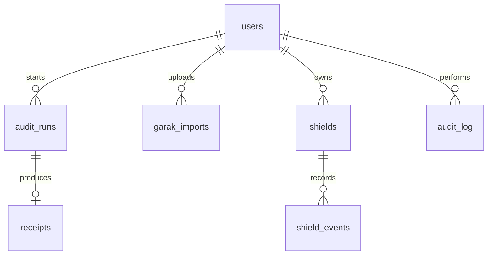

# Database.md

**Principle: the database never holds audit content.** It stores accounts and metadata only. Uploaded records, model outputs, prompts, canary values, garak prompts or outputs, API keys and PDFs are never written here. The database is **optional**: the product runs in demo mode with no database at all (demo users from environment variables, no run history).

Engine: PostgreSQL 15 or newer. ORM: SQLAlchemy 2 with Alembic migrations (optional). A free hosted Postgres is fine for the demo.

## 1. Tables

### users
| Column | Type | Notes |
|--------|------|-------|
| id | uuid PK | default `gen_random_uuid()` |
| email | text UNIQUE NOT NULL | |
| password_hash | text NOT NULL | argon2 or bcrypt only |
| role | text NOT NULL | `admin`, `auditor`, `viewer` |
| created_at | timestamptz NOT NULL | default `now()` |
| last_login_at | timestamptz | |

### audit_runs (metadata only)
| Column | Type | Notes |
|--------|------|-------|
| id | uuid PK | |
| user_id | uuid FK users(id) | |
| model_label | text NOT NULL | free label such as "demo-A-leaky". Not a path |
| mode | text NOT NULL | `evidence` or `extraction` |
| status | text NOT NULL | `completed`, `failed`, `cancelled` |
| records_count | int NOT NULL | number only |
| canaries_count | int NOT NULL | number only |
| risk_score | smallint | 0 to 100 |
| risk_band | text | LOW, MEDIUM, HIGH, CRITICAL |
| ci_low / ci_high | smallint | 95 percent interval |
| duration_ms | int | measured time |
| created_at | timestamptz NOT NULL | |

### receipts
| Column | Type | Notes |
|--------|------|-------|
| id | uuid PK | shown in the PDF |
| audit_run_id | uuid FK audit_runs(id) | nullable for session wipes |
| report_sha256 | text | hash of the PDF bytes |
| bytes_persisted | int NOT NULL | always 0 for audit content |
| created_at | timestamptz NOT NULL | |

### garak_imports (aggregated only)
| Column | Type | Notes |
|--------|------|-------|
| id | uuid PK | |
| user_id | uuid FK users(id) | |
| garak_version | text | from the report header if present |
| probes_total | int | |
| probes_with_hits | int | |
| summary | jsonb | probe name, detector, passed, total only. No prompts or outputs |
| created_at | timestamptz NOT NULL | |

### shields
| Column | Type | Notes |
|--------|------|-------|
| id | uuid PK | |
| owner_id | uuid FK users(id) | |
| name | text | |
| record_count | int | |
| index_fingerprint | text | hash of the salted index, not reversible to text |
| created_at | timestamptz NOT NULL | |

The Shield index itself lives in process memory (see Architecture.md), not in this table.

### shield_events (counts only)
| Column | Type | Notes |
|--------|------|-------|
| id | bigserial PK | |
| shield_id | uuid FK shields(id) | |
| action | text | `allowed`, `blocked`, `masked` |
| reason | text | `sequence_match` or `pattern:card` etc. Never the matched text |
| created_at | timestamptz NOT NULL | |

### audit_log
| Column | Type | Notes |
|--------|------|-------|
| id | bigserial PK | |
| user_id | uuid | |
| action | text | `login`, `audit_start`, `report_download`, `session_wipe` |
| created_at | timestamptz NOT NULL | |

## 2. Relationships



## 3. SQL (starter migration)

```sql
CREATE EXTENSION IF NOT EXISTS pgcrypto;

CREATE TABLE users (
  id uuid PRIMARY KEY DEFAULT gen_random_uuid(),
  email text UNIQUE NOT NULL,
  password_hash text NOT NULL,
  role text NOT NULL CHECK (role IN ('admin','auditor','viewer')),
  created_at timestamptz NOT NULL DEFAULT now(),
  last_login_at timestamptz
);

CREATE TABLE audit_runs (
  id uuid PRIMARY KEY DEFAULT gen_random_uuid(),
  user_id uuid NOT NULL REFERENCES users(id) ON DELETE CASCADE,
  model_label text NOT NULL,
  mode text NOT NULL CHECK (mode IN ('evidence','extraction')),
  status text NOT NULL CHECK (status IN ('completed','failed','cancelled')),
  records_count int NOT NULL CHECK (records_count >= 0),
  canaries_count int NOT NULL DEFAULT 0,
  risk_score smallint CHECK (risk_score BETWEEN 0 AND 100),
  risk_band text CHECK (risk_band IN ('LOW','MEDIUM','HIGH','CRITICAL')),
  ci_low smallint, ci_high smallint,
  duration_ms int,
  created_at timestamptz NOT NULL DEFAULT now()
);
CREATE INDEX idx_audit_runs_user ON audit_runs(user_id, created_at DESC);

CREATE TABLE receipts (
  id uuid PRIMARY KEY DEFAULT gen_random_uuid(),
  audit_run_id uuid REFERENCES audit_runs(id) ON DELETE SET NULL,
  report_sha256 text,
  bytes_persisted int NOT NULL DEFAULT 0 CHECK (bytes_persisted = 0),
  created_at timestamptz NOT NULL DEFAULT now()
);

CREATE TABLE garak_imports (
  id uuid PRIMARY KEY DEFAULT gen_random_uuid(),
  user_id uuid NOT NULL REFERENCES users(id) ON DELETE CASCADE,
  garak_version text,
  probes_total int NOT NULL,
  probes_with_hits int NOT NULL,
  summary jsonb NOT NULL,
  created_at timestamptz NOT NULL DEFAULT now()
);

CREATE TABLE shields (
  id uuid PRIMARY KEY DEFAULT gen_random_uuid(),
  owner_id uuid NOT NULL REFERENCES users(id) ON DELETE CASCADE,
  name text NOT NULL,
  record_count int NOT NULL,
  index_fingerprint text NOT NULL,
  created_at timestamptz NOT NULL DEFAULT now()
);

CREATE TABLE shield_events (
  id bigserial PRIMARY KEY,
  shield_id uuid NOT NULL REFERENCES shields(id) ON DELETE CASCADE,
  action text NOT NULL CHECK (action IN ('allowed','blocked','masked')),
  reason text,
  created_at timestamptz NOT NULL DEFAULT now()
);

CREATE TABLE audit_log (
  id bigserial PRIMARY KEY,
  user_id uuid,
  action text NOT NULL,
  created_at timestamptz NOT NULL DEFAULT now()
);
```

The `bytes_persisted = 0` check is deliberate. It makes the receipt claim enforceable by the schema.

## 4. Rules (mandatory)

1. Never add a column that can hold record text, prompts, outputs, canary values, keys or file bytes.
2. `garak_imports.summary` must be built by the parser's allow-list (probe, detector, passed, total). A test checks that no prompt or output text is present.
3. Retention: delete `audit_log` rows older than 30 days and `shield_events` older than 7 days. `audit_runs` can stay for the demo.
4. All writes go through the repository layer in `app/db/`. No raw SQL in routers.
5. If the database is unreachable, the API must keep working in demo mode and return `"persistence": "disabled"` in `/health`.
6. Hashing: Shield fingerprints use salted HMAC-SHA256. Never plain SHA-256 of short secrets (short numeric secrets can be brute-forced).
7. Backups: disable backups and point-in-time recovery for this database where the plan allows. It holds no content, but keep the claim simple.
